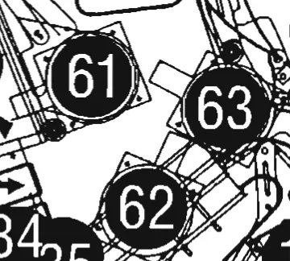

# Bumper lamp location drawing

Curator visually checked PDF 35 / printed 31 at native resolution. The tight
drawing crop shows lamp 61 at the rear/left bumper,63 at the rear/right bumper,
and 62 at the front/bottom bumper. These are location balloons, not calibrated
socket centres. The same page names61 Left,62 Bottom and 63 Right Turbo Bumper.

Both retained related scripts instead bind 62 to L62 at rear/right and 63 to L63
at front/bottom. Neither matching ancestry nor the separate switch drawing
settles the lamp discrepancy. Keep61 observed; withhold62/63 physical coordinates
pending production lamp-test illumination or socket matrix wire-pair evidence.

