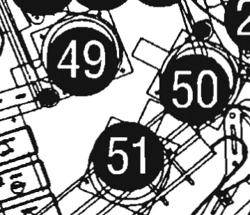

# Bumper switch location drawing

Curator visually checked PDF 33 / printed 29 at native resolution. The tight
drawing crop shows switch 49 at rear/left,50 at rear/right and 51 at front/bottom.
The table on that page nevertheless names49 Left,50 Bottom and 51 Right Turbo
Bumper. Preserve both literal names and drawn positions; a name alone cannot
transpose an address. Both retained tables assert49/50/51 from Bumper1/2/3 at
these drawn positions.

This is a switch map, while PDF 35's lamp drawing puts 62 front/bottom and 63
rear/right. It does not prove which lamp wire pair reaches either bulb socket.
The lamp discrepancy is therefore not resolved by matching bumper names.

